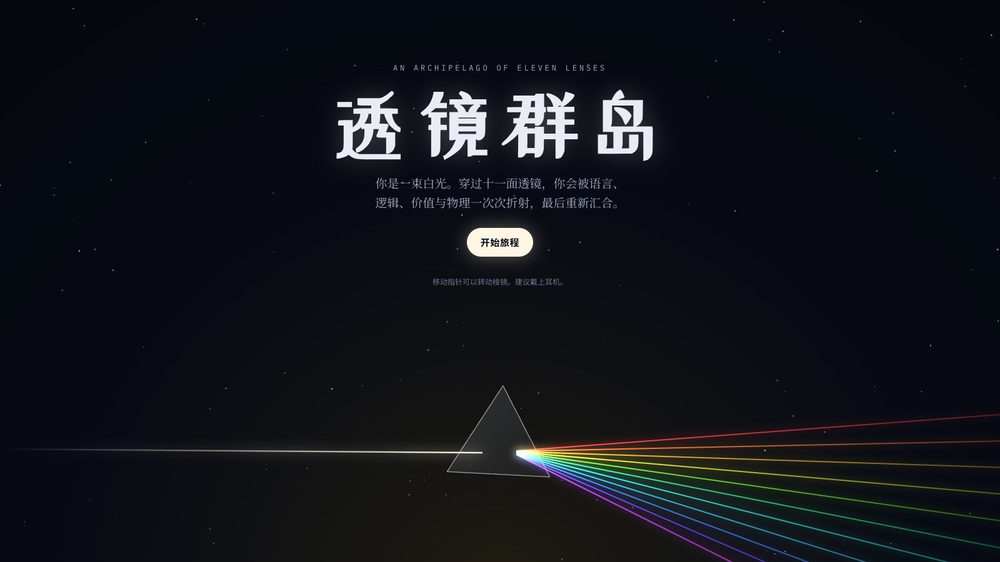
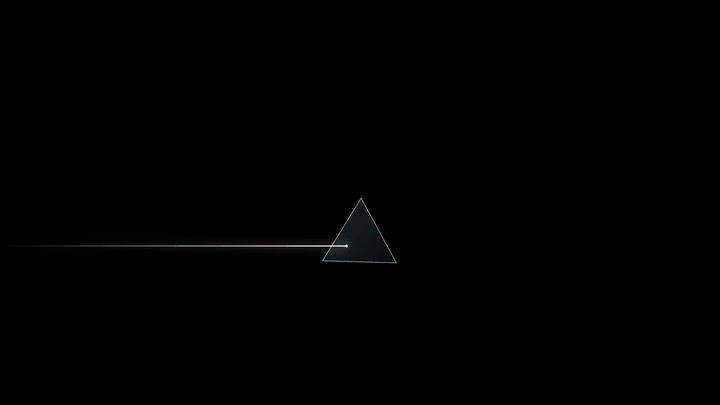
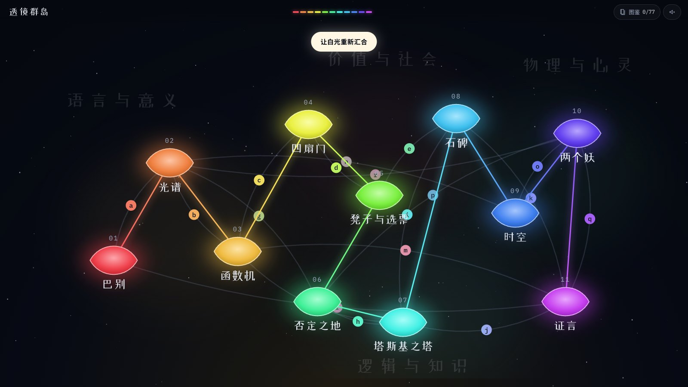
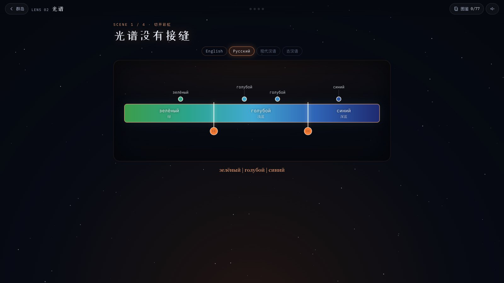
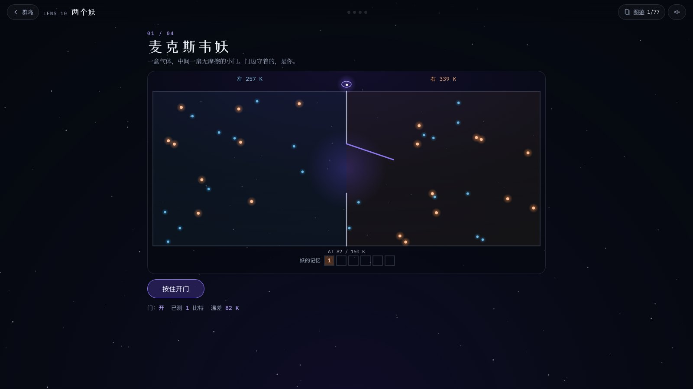
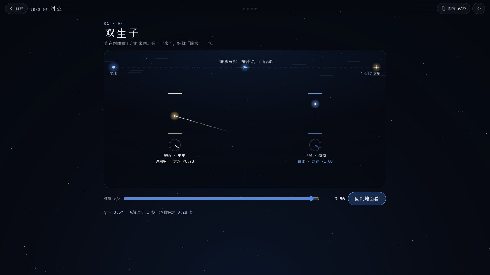
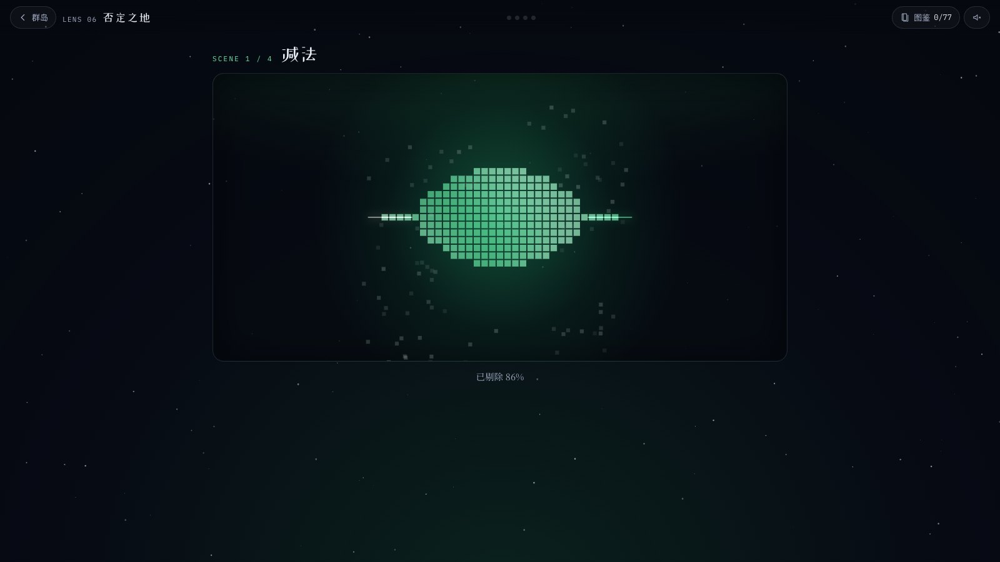
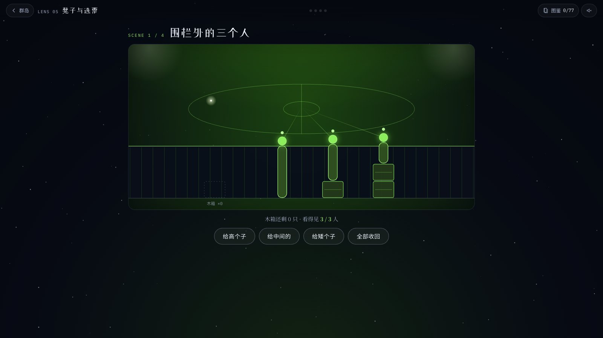
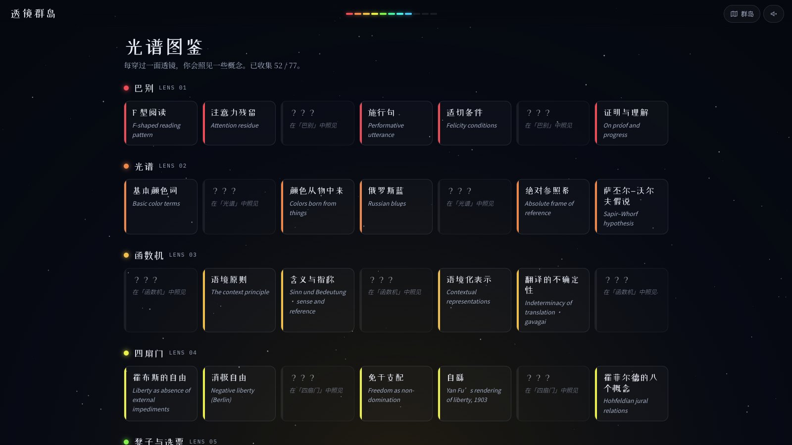

<div align="center">

<a href="https://polaris-aeterna.github.io/lens-archipelago/"></a>

<h1>透镜群岛</h1>

<p><b>你是一束白光。</b><br>
穿过十一面透镜，被语言、逻辑、价值与物理一次次折射，最后重新汇合。</p>

<p>
<a href="https://polaris-aeterna.github.io/lens-archipelago/"></a>


</p>

<p>
<a href="https://polaris-aeterna.github.io/lens-archipelago/"><b>立即游玩</b></a>
&nbsp;·&nbsp;
<a href="https://polaris-aeterna.github.io/lens-archipelago/media/trailer.mp4">观看宣传片（58 秒）</a>
&nbsp;·&nbsp;
<a href="#十一面透镜">十一面透镜</a>
&nbsp;·&nbsp;
<a href="#本地运行">本地运行</a>
</p>

</div>

<br>

## 这是什么

《透镜群岛》是一个在浏览器里玩的互动知识旅程，改编自一份关于语言、逻辑、价值与物理的精读笔记《语言是一面透镜》。笔记有十一章，群岛就有十一面透镜。

这里的知识不是读出来的，是**用手弄懂的**。你会亲手切开一道彩虹，去开一把被数学证明打不开的锁，当一回麦克斯韦妖并为遗忘付出热量，把飞船推向光速，看着“现在”倾斜。

<p align="center">

</p>

## 怎么玩

1. **出发**：在开场画面移动指针转动棱镜，然后点「开始旅程」。
2. **选岛**：十一座岛分布在 **语言与意义 · 价值与社会 · 逻辑与知识 · 物理与心灵** 四片大陆上，顺序随你。
3. **过关**：每面透镜有三到四幕，每一幕都是一个需要动手的小谜题。引路人“镜灵”只负责提示和点睛。
4. **收集**：每个恍然大悟的时刻都会照见一张概念卡。全游戏共 77 张，收在「光谱图鉴」里。
5. **连桥**：两座岛都点亮后，它们之间的知识之桥会亮起来，一共 18 座。点开桥，能看到两章之间的联系。
6. **汇合**：十一面透镜全部点亮后，回到群岛中央，让白光重新汇合。

> 进度保存在你自己的浏览器里，关掉再回来也不会丢。建议戴上耳机。

## 十一面透镜

| | 透镜 | 大陆 | 你会做的事 | 你会照见的概念 |
|:-:|:--|:--|:--|:--|
| 01 | **巴别** | 语言与意义 | 回放眼动记录，看 F 型阅读的热区；把句子送进一颗六棱晶体；在咒语大厅里说出能改变世界的话 | F 型阅读、雅各布森的六种功能、施行句、适切条件 |
| 02 | **光谱** | 语言与意义 | 用英语、俄语、古汉语的“刀”切开同一道光谱；做一次俄罗斯蓝实验；只用东南西北回答问题 | 基本颜色词、俄罗斯蓝、汉语的“青”、绝对参照系 |
| 03 | **函数机** | 语言与意义 | 给“青”拧不同的语境；拉开晨星与暮星的天幕；在词的星座里做向量运算；面对一只叫 gavagai 的兔子 | 概念是函数、含义与指称、分布语义、翻译的不确定性 |
| 04 | **四扇门** | 价值与社会 | 让四个人分别站到四扇“自由”的门前；在严复的工作台上翻译 liberty；拼合霍菲尔德的八块拼图 | 消极自由、积极自由、免于支配、自繇 |
| 05 | **凳子与选票** | 价值与社会 | 给围栏外的三个人分木箱；在无知之幕后抽签；让孔多塞循环转成一个环；去开阿罗之锁 | 向下拉平、张伯伦论证、孔多塞悖论、阿罗不可能定理 |
| 06 | **否定之地** | 逻辑与知识 | 凿掉一切“不是它”的部分；让一只黑天鹅推翻一千只白天鹅；转动四句之轮；在有边和无边的牌桌上排除 | 否定法、证伪的不对称、排中律、四句、遮诠与表诠 |
| 07 | **塔斯基之塔** | 逻辑与知识 | 让“这句话是假的”停止闪烁；下到递归之井；在可能世界之间画箭头；看一只停了的钟 | T 模式、元语言、丘奇–图灵论题、可能世界、盖提尔问题 |
| 08 | **石碑** | 价值与社会 | 给赛艇设计奖励，看它学会刷分；替飞船 AI 补约束；搭一座从“是”到“应当”的桥；让两台程序互读源代码 | 规格博弈、古德哈特定律、框架问题、勒布式合作 |
| 09 | **时空** | 物理与心灵 | 把飞船推向光速；拖动倾斜的“现在”；切换时间的三种看法；转动一支旋火轮 | 时间膨胀、时空间隔、同时性的相对性、块宇宙 |
| 10 | **两个妖** | 物理与心灵 | 当麦克斯韦妖分拣分子，为遗忘付热；给网络加回路看 Φ；在双缝旁放一个探测器；借拉普拉斯妖的眼睛看一眼 | 兰道尔原理、整合信息理论、退相干、阿莱夫 |
| 11 | **证言** | 逻辑与知识 | 数一数你的知识有多少是“听来的”；在休谟与里德之间选边；判断镜灵的八条证词 | 证言知识、陈述观、AI 证言、流畅性陷阱、校准 |

## 截图

<table>
<tr>
<td width="50%"><br><sub>群岛：两座岛都点亮，它们之间的知识之桥就会亮起</sub></td>
<td width="50%"><br><sub>光谱：用俄语的刀，把蓝切成两种</sub></td>
</tr>
<tr>
<td><br><sub>两个妖：当麦克斯韦妖，然后为遗忘付出代价</sub></td>
<td><br><sub>时空：把飞船推向光速，看谁的时间变慢了</sub></td>
</tr>
<tr>
<td><br><sub>否定之地：凿掉一切“不是它”的部分</sub></td>
<td><br><sub>凳子与选票：三只木箱，怎样分才算公平</sub></td>
</tr>
<tr>
<td><br><sub>证言：镜灵的证词，你信几句？</sub></td>
<td><br><sub>光谱图鉴：77 张概念卡，每张都有出处</sub></td>
</tr>
</table>

## 关于镜灵

<details>
<summary>轻微剧透，点开再看</summary>
<br>

在最后一面透镜里，镜灵会回顾它一路上说过的八句话，每一句都带着九成以上的把握。其中有四句是错的。

你只有三次查证机会。

然后它会告诉你一件你也许早就猜到的事：一路陪着你的引路人，本身就是一个 AI。

</details>

## 设计

- **画面**：夜里的光学台。十一面透镜各有一种光谱色，点亮一面，光束就多一种颜色。所有画面都由 Canvas 与 SVG 实时绘制，没有用一张图片素材。
- **声音**：环境音和音效由 Web Audio 实时合成，每座岛有自己的调性。
- **字体**：标题用站酷小薇体，正文用思源宋体，标签与数字用 IBM Plex Mono。
- **可达性**：支持键盘操作；系统开启“减少动态效果”时会关闭持续动画；手机竖屏也能玩。

## 本地运行

不需要构建，也没有任何依赖。克隆仓库后，在仓库目录里启动任意一个静态服务器：

```bash
python3 -m http.server 8000
```

然后打开 <http://localhost:8000>。在网址后面加锚点可以直接跳转：`#l05` 进入第五面透镜，`#map` 是群岛地图，`#codex` 是光谱图鉴。

## 目录结构

```text
lens-archipelago/
├── index.html      页面外壳与全部样式
├── engine.js       引擎：开场、群岛地图、知识之桥、图鉴、镜灵、声音、关卡 API
├── finale.js       终章：白光汇合、纽拉特之船、带走的问题
├── levels/         十一面透镜，每面一个文件（l01.js … l11.js）
└── media/          截图、预览动图与宣传片
```

## 知识来源

游戏里的知识都来自《语言是一面透镜》的正文与参考文献。主要文献如下：

| 透镜 | 主要来源 |
|:--|:--|
| 巴别 | Jakobson, *Linguistics and Poetics*（1960）；Austin, *How to Do Things with Words*（1962）；Wittgenstein, *Tractatus*（1922）；Thurston, *On Proof and Progress in Mathematics*（1994） |
| 光谱 | Berlin & Kay, *Basic Color Terms*（1969）；Winawer et al., *Russian Blues*（2007）；Deutscher, *Through the Language Glass*（2010）；Levinson, *Space in Language and Cognition*（2003） |
| 函数机 | Frege, *Funktion und Begriff*（1891）与 *Über Sinn und Bedeutung*（1892）；Firth（1957）；Quine, *Word and Object*（1960）；Saussure, *Cours de linguistique générale*（1916） |
| 四扇门 | Berlin, *Two Concepts of Liberty*（1958）；Pettit, *Republicanism*（1997）；严复译《群己权界论》（1903）；Hohfeld（1913）；Pitkin, *Are Freedom and Liberty Twins?*（1988） |
| 凳子与选票 | Rawls, *A Theory of Justice*（1971）；Nozick, *Anarchy, State, and Utopia*（1974）；Parfit, *Equality and Priority*（1997）；Arrow, *Social Choice and Individual Values*（1951）；Sen（1970） |
| 否定之地 | Taleb, *Antifragile*（2012）；Popper, *The Logic of Scientific Discovery*（1959）；Quine, *Two Dogmas of Empiricism*（1951）；Garfield & Priest（2003）；Priest, *The Fifth Corner of Four*（2018） |
| 塔斯基之塔 | Tarski（1944）；Turing（1936）；Church（1936）；Kripke（1963）；Gettier（1963） |
| 石碑 | Russell, *Human Compatible*（2019）；Amodei et al., *Concrete Problems in AI Safety*（2016）；Tennenholtz, *Program Equilibrium*（2004）；Barasz et al.（2014）；Hume, *Treatise*（1739） |
| 时空 | Einstein（1905）；Minkowski, *Raum und Zeit*（1908）；McTaggart, *The Unreality of Time*（1908）；Rovelli, *The Order of Time*（2018） |
| 两个妖 | Landauer（1961）；Bennett（1982）；Bérut et al.（2012）；Tononi（2004）；Chalmers（1995）；Egginton, *The Rigor of Angels*（2023） |
| 证言 | Coady, *Testimony*（1992）；Lackey, *Learning from Words*（2008）；Freiman, *AI-Testimony*（2024）；Reber & Schwarz（1999） |

## 制作

- 游戏的设计与开发由 Claude（Anthropic 的 AI）完成：一个主会话负责引擎、地图、图鉴、终章与第十一面透镜，五个子代理并行开发第一到第十面透镜。
- 宣传片的画面全部录自游戏本身，配乐由 ElevenLabs Music 生成。

## 一个提醒

游戏里的知识都对照过原始文献，但仍然可能有错。正如最后一面透镜所说：一路陪你的引路人是一个 AI，它说的每一句话都是**证言**，值得一听，也值得查证。发现错误的话，欢迎提 Issue。
